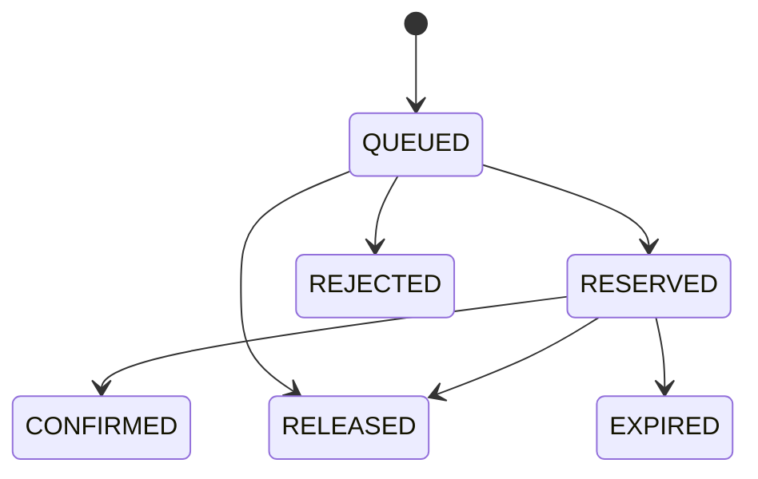

# 通用秒杀服务

面向小程序、自建网站和可信业务后端的通用秒杀模块，采用 Java 25、Spring Boot 4.1.2、MySQL 8.4、Redis 8.2、RabbitMQ 4.2，以及 Vue 3 / TypeScript 演示工作台。以模块化单体实现库存一致性与异步排队，适合学习、PoC 和二次开发。

独立提供活动配额、异步抢购、限购、库存预占、成交确认和超时释放。小程序、自建网站与其他业务系统由各自的可信后端接入。同一业务的多个渠道共用同一接入方身份和用户编号，从而共用库存与限购。

当前实现面向按数量销售的商品、非选座票和预约名额。接入方负责登录、业务资格、活动配额划拨、订单、支付核验、发货或出票。

## 文档导航

| 文档 | 内容 |
| --- | --- |
| [需求与验收](docs/requirements.md) | 适用场景、业务职责、现有功能与验收要求 |
| [接口与接入要求](docs/integration.md) | API、字段限制、认证、幂等、回调及业务后端接口需求 |
| [OpenAPI 3.1](docs/openapi.yaml) | 可供接口工具导入的机器可读契约 |
| [架构说明](docs/architecture.md) | 数据流、事务、消息恢复和部署边界 |
| [扩展需求与路线](docs/extensions.md) | 待实现能力、改动位置和验收标准 |
| [验证记录](docs/verification.md) | 历史测试结果及容量结论的适用范围 |
| [阶梯负载与过载实测](docs/performance-2026-11-08.md) | 受理与预占延迟、限流、突发、库存核对及容量风险 |
| [Redis 预扣版本压测](docs/performance-2026-11-11.md) | 阶梯负载、台账核对、死锁证据及锁序修复复测 |
| [批量处理与吞吐复测](docs/performance-throughput-2026-11-11.md) | 投递退避、批量事务、同步隔离及故障回归 |
| [批量大小与单热点吞吐复测](docs/performance-batch-2026-11-11.md) | 批 1／8／16 对照、1000/s 突发与 500/s 稳态、单活动上限 |
| [小程序接入示例](miniprogram/README.md) | 调用业务后端的 TypeScript 封装与接入前提 |

当前已实现异步受理、库存预占、用户限购、幂等、取消/到期释放、多接入方隔离、签名通知与基础指标。真实登录、支付、退款、选座和生产高可用属于接入或扩展工作，详见上述文档。

## 本机启动

需要 Java 25、Maven、Node.js 22.12+ 或 24、Docker Desktop（Linux 容器），以及 PowerShell 7。`git`、`java`、`mvn`、`npm` 和 `docker` 需要可从终端调用。以下命令在 PowerShell 7 中执行，Java 路径请替换为自己的安装目录。

```powershell
git clone https://github.com/zzzzzj222/flash-sale-platform.git
cd flash-sale-platform
./scripts/start.ps1 -JavaHome D:\Java\jdk25
```

脚本生成独立随机凭证，写入已忽略的 `.env`，启动 MySQL、Redis、RabbitMQ，构建网页与后端，然后在前台启动服务。打开 <http://127.0.0.1:18080>。本地页面可以创建活动、更换演示用户、抢购、模拟付款和取消。`Ctrl+C` 停止 Java 服务，`docker compose stop` 停止本项目的依赖。

已有构建时可以使用 `-SkipBuild`。通过 `docker compose down` 移除容器，命名卷保留数据。备份和恢复应另行制定并验证。

演示页面只在 `DEMO_ENABLED=true` 时开放。演示业务接口进一步检查本机来源和同源访问。生产接入使用 `/api/v1`，通过环境配置接入凭证和 HTTPS。

演示模式使用手填用户编号和模拟订单号，抢购、预占和释放仍会实际写入数据库。`.env.example` 仅说明变量名称；首次启动让脚本生成 `.env`，不要将示例占位符作为密码。Compose 只启动三项中间件，应用由启动脚本运行；`deploy/Dockerfile` 是另一种应用构建示例，尚未完成部署验收。

## 项目结构

| 目录 | 内容 |
| --- | --- |
| `backend` | Spring Boot 服务、数据库迁移、测试 |
| `web` | Vue 3 / TypeScript 本地演示工作台 |
| `miniprogram` | 微信小程序业务后端调用示例 |
| `docs` | 接入契约、架构与实际验证记录 |
| `scripts` | 初始化、启动和验证脚本 |
| `load` | k6 压测脚本 |
| `deploy` | 容器与入口部署示例 |

## 可靠性流程

1. Redis 检查全局、接入方、用户三层频率。Redis 不可用时返回 `503`。
2. Redis Lua 原子完成请求去重、库存预扣和用户限购，保存申请与待投递记录后返回 `202`。售罄或累计超限可直接返回 `REJECTED` 结果，并异步保存到 MySQL。
3. 投递程序用带令牌的租约认领 Redis 待处理申请，同活动组成持久消息（`SALE_BATCH_SIZE`，默认 16，设为 1 即逐条投递），等待 RabbitMQ 发布确认。失败按 1 秒起步退避，上限 30 秒；确认后等待 15 秒起步，上限 60 秒，加入 20% 抖动并受业务期限约束。领取租约默认 30 秒，旧回调无法覆盖新租约。
4. 消费者在 MySQL 事务中先锁定活动行，再批量保存和锁定申请，复用本批库存与额度视图，一次写入各申请结果。正常业务拒绝只影响对应申请，技术异常使该小批次整体回滚并重试；批次因数据或不变式错误回滚时逐条重试，把失败范围收窄到单条申请。事务成功返回后确认消息，重复投递通过主键及状态去重，旧单条消息继续兼容。
5. 每次结果变化在同事务批量保存 Redis 同步任务和可选 Webhook。提交后用一次 Lua 尝试同步本批结果。独立同步程序每轮最多认领 64 个事件，批量跳过已同步版本并完成事件；申请投递、到期处理和通知使用独立有界线程池。
6. 后台扫描已落库的排队和付款到期记录。Redis 中尚未落库且已到排队期限的申请由后台直接执行落库和超时判断，RabbitMQ 中断时也可结束申请。确认、取消和超时均先锁活动，再锁申请，与消费事务保持一致的加锁顺序。
7. Redis 待投递记录在数据库结果同步完成后移除。业务通知按稳定事件编号重试，失败通知可查询和人工重新投递。

批量消息上线时先完成消费者升级，再启用新版批量投递。旧版消费者仅识别单个 JSON 对象，新版消费者同时兼容历史单条消息和批量数组；本机可先停止旧 worker，再统一启动新版。

入口活动和排队期限使用 Redis 时间计算，最终预占、确认和超时使用数据库时间裁定，各节点需保持时间同步。业务时间对外使用 ISO 8601。状态和 SQL 索引以接入方为边界，用户限购统计包含待落库预扣、有效预占和已成交数量，取消及过期归还限购量。

请求状态如下。



`202` 表示申请已记录在 Redis 并等待异步落库，响应也可能已经是 `REJECTED`。只有 `RESERVED` 才允许进入业务下单支付。付款核验后由业务后端确认 `CONFIRMED`。付款晚于预占有效期时返回 `409`，业务系统负责退款或异常处置。

Redis 库存台账与待投递记录使用独立命名空间，持续保留，部署必须启用 AOF、`appendfsync always`、持久卷及 `noeviction`，Compose 已配置这些选项。活动规则的普通缓存仍使用短期 TTL。Redis 台账不能通过缓存清理、`FLUSHDB` 或单独回滚备份处理。首次使用会从 MySQL 导入租户活动、额度和历史申请，后续热路径提交直接访问 Redis。升级时先停止旧版写入实例，再启动新版，避免两种入口并行修改配额。恢复或迁移时需协调 MySQL、Redis 与 RabbitMQ 的数据版本；Redis 持久数据与尚未发送的申请同时丢失时，MySQL 无法恢复这些申请。

## 验证

Docker Desktop 启动后运行以下命令。Testcontainers 使用独立容器与测试数据。

```powershell
./scripts/verify.ps1 -JavaHome D:\Java\jdk25
```

测试覆盖并发库存、限购、重复提交、重复消息、跨接入方隔离、权限、确认、取消、到期、消息队列中断、Redis 中断和通知重试。实际执行结果记录在 `docs/verification.md`。

## 扩展与容量

同一代码库可作为 API 实例或处理实例部署。设置 `WORKERS_ENABLED=false` 关闭 API 实例的消费者、事件投递和过期扫描，处理实例保持开启。多个处理实例使用数据库锁、事件租约和 `SKIP LOCKED` 协调。

热路径入口使用 Redis，MySQL 由后台异步写入，首次初始化和新活动载入需要读取数据库。RabbitMQ 与 Redis 待投递记录缓冲处理压力，单热点资源的数据库锁和后台落库速度仍会限制最终完成吞吐。准入默认全局 2000 次/秒、每接入方 1000 次/秒、每用户 3 次/秒；单活动实测持续落库约 500～600/s，1000/s 的 30 秒突发可全部预占成功但积压峰值约 1.3 万。后台批量处理与同步隔离结果见 [最新吞吐复测](docs/performance-throughput-2026-11-11.md)，批量参数对照见 [批量大小复测](docs/performance-batch-2026-11-11.md)，历史锁序修复见 [压测报告](docs/performance-2026-11-11.md)。容量应结合运行环境与延迟目标评估。

`ADMISSION_GLOBAL`、`ADMISSION_CLIENT`、`ADMISSION_USER`、`CONSUMERS`、`MAX_CONSUMERS`、`DB_POOL_SIZE`、`QUEUE_LIMIT`、`SALE_BATCH_SIZE`、`REQUEST_PUBLISH_WAIT_MS`、`REQUEST_CLAIM_LEASE_MS` 可通过环境配置。重试默认值应结合处理与排队 P99、故障恢复和业务期限调整，具体边界见 [架构说明](docs/architecture.md#投递与重试)。排队有效期按活动设置，RabbitMQ 队列满时拒绝新的发布，由 Redis 待投递记录重新发送，直到完成或到期。`QUEUE_LIMIT` 按 RabbitMQ 消息条数计数，每条最多 16 个申请；`SALE_BATCH_SIZE` 只影响生产端打包，调小无需停机；Redis pending 和数据库申请数按逻辑申请计数。需监控积压、内存及 AOF 磁盘使用。`flashsale.requests.pending.persistence` 表示 Redis 中尚待完成落库或结果同步的申请数，Redis 读取失败时为 -1；已有排队数及等待时间指标继续统计 MySQL 中的记录。

首版活动分页上限 100 条，演示用户记录上限 30 条。数据量增长时应增加游标分页、归档和事件清理策略。当前尚未验证几万并发、高可用集群、跨机故障恢复或生产环境部署。

未来接入 Spring Cloud 时，先维持库存、限购和预占的事务边界，再按实际需求加入网关、服务发现与配置管理。活动和预占的持久化数据由本服务管理，外部系统通过接口或事件交互。

## 参与开发与开源许可

欢迎通过 GitHub Issues 提交问题或扩展需求。请附上运行版本、复现步骤、预期与实际结果，删除日志中的凭证和个人数据。贡献前先阅读需求与接入边界，修改行为时同步契约及相关测试，并运行验证脚本。扩展文档中的条目是待实现方向，不构成交付承诺。

本项目采用 [MIT License](LICENSE)，允许在保留许可声明的前提下使用、修改、分发和商用。第三方依赖仍遵循各自许可证。本项目按现状提供，正式业务接入需完成安全、容量和支付一致性验收。
