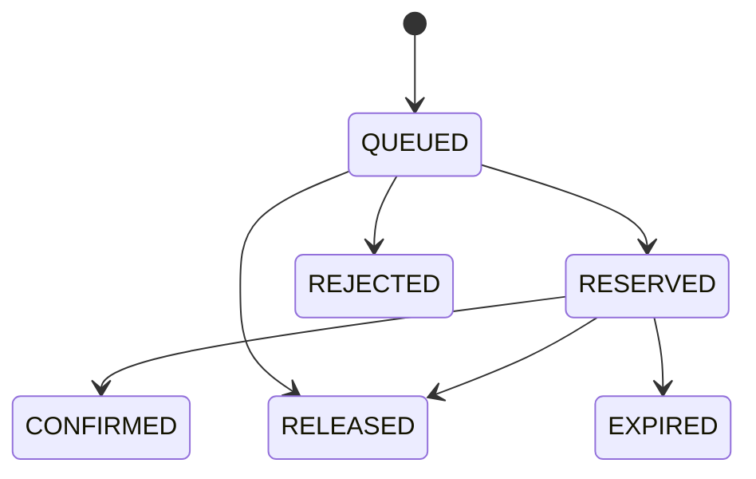

# 通用秒杀服务

面向小程序、自建网站和可信业务后端的通用秒杀模块，采用 Java 25、Spring Boot 4.1.2、MySQL 8.4、Redis 8.2、RabbitMQ 4.2，以及 Vue 3 / TypeScript 演示工作台。以模块化单体实现库存一致性与异步排队，适合学习、PoC 和二次开发。

独立提供活动配额、异步抢购、限购、库存预占、成交确认和超时释放。小程序、自建网站与其他业务系统由各自的可信后端接入。同一业务的多个渠道共用同一接入方身份和用户编号，从而共用库存与限购。

当前实现面向按数量销售的商品、非选座票和预约名额。接入方负责登录、业务资格、活动配额划拨、订单、支付核验、发货或出票。

## 文档导航

| 文档 | 内容 |
| --- | --- |
| [需求与验收](docs/requirements.md) | 适用场景、业务职责、现有功能与验收要求 |
| [接口与接入要求](docs/integration.md) | API、字段限制、认证、幂等、回调及业务后端接口需求 |
| [OpenAPI 3.1](docs/openapi.yaml) | 可供接口工具导入的机器可读契约 |
| [架构说明](docs/architecture.md) | 数据流、事务、消息恢复和部署边界 |
| [扩展需求与路线](docs/extensions.md) | 待实现能力、改动位置和验收标准 |
| [验证记录](docs/verification.md) | 历史测试结果及容量结论的适用范围 |
| [阶梯负载与过载实测](docs/performance-2026-11-08.md) | 受理与预占延迟、限流、突发、库存核对及容量风险 |
| [小程序接入示例](miniprogram/README.md) | 调用业务后端的 TypeScript 封装与接入前提 |

当前已实现异步受理、库存预占、用户限购、幂等、取消/到期释放、多接入方隔离、签名通知与基础指标。真实登录、支付、退款、选座和生产高可用属于接入或扩展工作，详见上述文档。

## 本机启动

需要 Java 25、Maven、Node.js 22.12+ 或 24、Docker Desktop（Linux 容器），以及 PowerShell 7。`git`、`java`、`mvn`、`npm` 和 `docker` 需要可从终端调用。以下命令在 PowerShell 7 中执行，Java 路径请替换为自己的安装目录。

```powershell
git clone https://github.com/zzzzzj222/flash-sale-platform.git
cd flash-sale-platform
./scripts/start.ps1 -JavaHome D:\Java\jdk25
```

脚本生成独立随机凭证，写入已忽略的 `.env`，启动 MySQL、Redis、RabbitMQ，构建网页与后端，然后在前台启动服务。打开 <http://127.0.0.1:18080>。本地页面可以创建活动、更换演示用户、抢购、模拟付款和取消。`Ctrl+C` 停止 Java 服务，`docker compose stop` 停止本项目的依赖。

已有构建时可以使用 `-SkipBuild`。通过 `docker compose down` 移除容器，命名卷保留数据。备份和恢复应另行制定并验证。

演示页面只在 `DEMO_ENABLED=true` 时开放。演示业务接口进一步检查本机来源和同源访问。生产接入使用 `/api/v1`，通过环境配置接入凭证和 HTTPS。

演示模式使用手填用户编号和模拟订单号，抢购、预占和释放仍会实际写入数据库。`.env.example` 仅说明变量名称；首次启动让脚本生成 `.env`，不要将示例占位符作为密码。Compose 只启动三项中间件，应用由启动脚本运行；`deploy/Dockerfile` 是另一种应用构建示例，尚未完成部署验收。

## 项目结构

| 目录 | 内容 |
| --- | --- |
| `backend` | Spring Boot 服务、数据库迁移、测试 |
| `web` | Vue 3 / TypeScript 本地演示工作台 |
| `miniprogram` | 微信小程序业务后端调用示例 |
| `docs` | 接入契约、架构与实际验证记录 |
| `scripts` | 初始化、启动和验证脚本 |
| `load` | k6 压测脚本 |
| `deploy` | 容器与入口部署示例 |

## 可靠性流程

1. Redis 检查全局、接入方、用户三层频率。Redis 不可用时返回 `503`。
2. 在同一个 MySQL 事务中保存 `QUEUED` 请求和待发送事件，事务提交后返回 `202`。
3. 事件投递程序使用带租约的任务认领和发布确认，发送持久消息到 RabbitMQ。
4. 消费者锁定请求及活动，在同一个事务内处理库存、用户限购、结果和业务通知。
5. 消费者在事务提交后确认消息。重复投递通过请求状态去重。
6. 后台扫描排队到期和付款到期的请求。确认、取消和超时通过同一请求行锁互斥。
7. 业务通知按稳定事件编号重试。失败通知可查询和人工重新投递。

数据库时间作为活动判断与过期判断的时间来源，业务时间对外使用 ISO 8601。状态和 SQL 索引以接入方为边界，用户限购统计包含有效预占和已成交数量，取消及过期归还限购量。

请求状态如下。



`202` 表示请求已持久化并等待处理。只有 `RESERVED` 才获得配额。付款核验后由业务后端确认 `CONFIRMED`。付款晚于预占有效期时返回 `409`，业务系统负责退款或异常处置。

## 验证

Docker Desktop 启动后运行以下命令。Testcontainers 使用独立容器与测试数据。

```powershell
./scripts/verify.ps1 -JavaHome D:\Java\jdk25
```

测试覆盖并发库存、限购、重复提交、重复消息、跨接入方隔离、权限、确认、取消、到期、消息队列中断、Redis 中断和通知重试。实际执行结果记录在 `docs/verification.md`。

## 扩展与容量

同一代码库可作为 API 实例或处理实例部署。设置 `WORKERS_ENABLED=false` 关闭 API 实例的消费者、事件投递和过期扫描，处理实例保持开启。多个处理实例使用数据库锁、事件租约和 `SKIP LOCKED` 协调。

数据库在入口保存请求及事件，仍需承担被接纳流量的写入。RabbitMQ 隔离后续库存事务的突发竞争，单热点资源的数据库锁仍是潜在瓶颈。当前默认全局 500 次/秒、每接入方 200 次/秒、每用户 3 次/秒属于保守配置，容量需要结合机器与延迟目标实测。

`ADMISSION_GLOBAL`、`ADMISSION_CLIENT`、`ADMISSION_USER`、`CONSUMERS`、`MAX_CONSUMERS`、`DB_POOL_SIZE`、`QUEUE_LIMIT` 可通过环境配置。排队有效期按活动设置，RabbitMQ 队列满时拒绝新的发布并由数据库事件重试，直到请求到期。排队上限与限流共同约束压力。

首版活动分页上限 100 条，演示用户记录上限 30 条。数据量增长时应增加游标分页、归档和事件清理策略。当前尚未验证几万并发、高可用集群、跨机故障恢复或生产环境部署。

未来接入 Spring Cloud 时，先维持库存、限购和预占的事务边界，再按实际需求加入网关、服务发现与配置管理。活动和预占的持久化数据由本服务管理，外部系统通过接口或事件交互。

## 参与开发与开源许可

欢迎通过 GitHub Issues 提交问题或扩展需求。请附上运行版本、复现步骤、预期与实际结果，删除日志中的凭证和个人数据。贡献前先阅读需求与接入边界，修改行为时同步契约及相关测试，并运行验证脚本。扩展文档中的条目是待实现方向，不构成交付承诺。

本项目采用 [MIT License](LICENSE)，允许在保留许可声明的前提下使用、修改、分发和商用。第三方依赖仍遵循各自许可证。本项目按现状提供，正式业务接入需完成安全、容量和支付一致性验收。
