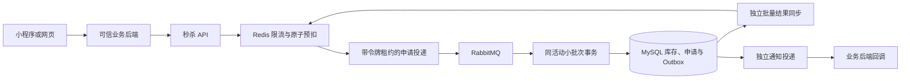

# 架构与演进边界

## 部署与模块

`api` 提供经过认证的接入接口。`core` 管理活动、库存、限购与预占事务。`messaging` 管理数据库事件、队列投递、消费与业务通知。`demo` 是默认关闭的本地演示业务后端。

API 接纳请求时由 Redis Lua 完成库存和限购预扣，同时保存申请及 pending 索引。后台携带完整快照异步落库，旧单条消息继续兼容。MySQL 业务结果与 Redis 同步、业务通知事件在同一事务提交，Redis pending 在数据库结果同步完成后移除。

## 并发与恢复

处理顺序固定为活动行、申请行、用户限购行。生产端把同租户、同活动的申请组成小批次（`SALE_BATCH_SIZE`，默认 16，最大 16，设为 1 即逐条投递），批量插入申请、读取当前状态和额度，在锁内按批次顺序决定各申请结果，一次更新库存、累计额度和申请状态，并批量插入 Outbox。条件库存更新和数据库约束继续校验库存上下界、额度非负。

售罄、限购和超时属于逐申请的业务结果。SQL 异常等技术故障使该小批次整体回滚，消费者重试同一批消息。数据或不变式错误回滚后，消费者逐条重试，避免一条坏申请拖整批进死信。提交成功后的确认丢失通过幂等恢复。确认、释放和已落库的到期任务采用相同锁序，按单个请求执行。

Outbox 使用 `READ COMMITTED`、`FOR UPDATE SKIP LOCKED` 和 60 秒租约认领，多实例可以竞争不同事件。Redis 同步每轮最多领取 64 条，默认完成一轮后等待 50ms，按租户批量读取已同步版本，缺失版本通过一条 Lua 补齐，并批量完成事件。Webhook 与旧 Rabbit 事件独立领取，最多 16 条、默认延迟 100ms。领取和完成标记校验租约归属，旧投递者不能覆盖新投递结果。事件可能重复或乱序，消费者、Lua 和接入方保持幂等。

Redis 时间确定入口排队期限，MySQL 时间裁定最终预占和付款有效期。已落库的过期任务每次选取最多 100 条候选，逐申请独立事务处理。尚未落库的到期申请交给独立有界执行器，按同活动最多 16 条处理，Broker 阻塞期间仍能清理。申请发布、到期清理、Redis 同步和通知分别限制并发及等待队列，容量耗尽时申请保留在持久台账中并退避。

## 投递与重试

重投时长需结合端到端处理 P99、故障检测时间及业务期限确定。本项目采用以下可调默认值，现场部署需通过对应负载和故障恢复验证。

| 情况 | 默认策略 |
| --- | --- |
| 领取后未得到发布结果 | 30 秒租约，`REQUEST_CLAIM_LEASE_MS` 可调 |
| 发布失败或无法确认 | 1、2、4、8、16、30 秒指数退避，上限 30 秒 |
| Broker 已确认发布，结果尚未完成 | 15、30、60 秒等待，上限 60 秒，首个间隔由 `REQUEST_PUBLISH_WAIT_MS` 配置 |
| 避免集中重试 | 上述退避加入 20% 抖动，总等待保持在对应上限内 |
| 业务排队期限早于下次重投 | 截断到业务期限，随后直接执行超时处理 |
| 到期处理本身失败 | 按失败退避继续恢复，完成前保留预扣与 pending |

发布结果通过领取令牌更新重试时间，过期投递者、重复回调及结果完成后的回调均无法恢复旧任务。生产端消息使用持久化与 publisher confirm，数据库事务成功返回后消费者确认消息，异常沿用容器的三次重试和死信路径。确认及连接故障可能产生重复，需要应用幂等。[RabbitMQ 可靠性说明](https://www.rabbitmq.com/docs/reliability)

批量数组消息上线前先升级消费者，确保所有接收者支持新格式，再启用新版批量投递。新版保留旧单条消息兼容，本机可在停止旧 worker 后统一升级。V4 迁移增加 Outbox 目标扫描索引。

## 可扩展范围

同一资源的库存、用户限购与预占保持在同一数据库事务内。业务系统对资源编号、用户编号、资格、订单和支付做映射。第一版按数量销售，指定座位、连座和多个资源的原子预占需要新增业务策略与一致性测试。

后续接入 Spring Cloud 时，可独立部署 API、处理程序与通知程序，逐步接入网关、配置和发现。拆分持久化归属前要重新设计跨服务一致性，库存与限购应继续由一个服务负责。

## 当前容量边界

RabbitMQ 队列配置长度上限及 `reject-publish`，发送方处理确认与不可路由返回。长度按消息条数计数，每条最多 16 个逻辑申请。Redis pending 按申请计数，并保留至数据库结果同步完成。队列满或不可用时申请退避重试，到达活动排队期限后直接落库终止。入口限流控制已接纳请求的后台压力。

单活动行锁会限制单热点吞吐。增加消费者有助于处理不同活动，过量消费者可能增加锁等待。本机实测单活动持续落库约 500～600/s：1000/s 的 30 秒突发可以全部预占成功，但积压峰值约 1.3 万、成功 P95 约 22 秒；批量为 1 时同一负载下 93% 排队超时。数据见 [批量大小与单热点吞吐复测](performance-batch-2026-11-11.md)。生产阶段需测试单热点、多活动、多接入方、重复请求、结果轮询、网络故障与服务重启。

当前数据库、缓存和消息队列采用单节点开发部署。高可用生产部署、容量规划、灾备恢复、真实支付与票务资格校验仍需独立验收。
