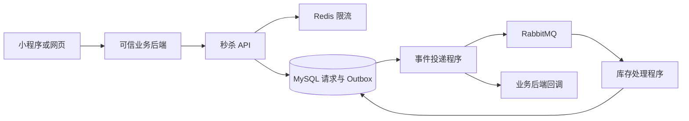

# 架构与演进边界

## 部署与模块

`api` 提供经过认证的接入接口。`core` 管理活动、库存、限购与预占事务。`messaging` 管理数据库事件、队列投递、消费与业务通知。`demo` 是默认关闭的本地演示业务后端。

API 接纳请求时写入数据库，请求账本与待发送事件具有相同事务生命周期。该选择增加入口数据库写入，以持久性和故障恢复为优先。若后续压测证明入口写入成为瓶颈，再设计基于可靠消息接纳的流程及结果可查询契约。

## 并发与恢复

处理顺序固定为请求行、活动行、用户限购行。事务完成库存和限购变化，数据库约束进一步校验库存上下界与配额非负。确认、释放和到期任务先锁定同一请求行，使终态变更互斥。

Outbox 使用 `READ COMMITTED`、`FOR UPDATE SKIP LOCKED` 和租约认领，多实例可以竞争不同事件。消息或通知成功后标记已交付，实例在成功投递后、标记前崩溃时可能重复投递，消费者和接入方需要幂等。

期限由数据库时间计算。过期任务每次选取最多 100 条候选，单条独立事务处理，防止一个大批次长期持有多个活动锁。服务中断后，持久化记录允许继续扫描和释放。

## 可扩展范围

同一资源的库存、用户限购与预占保持在同一数据库事务内。业务系统对资源编号、用户编号、资格、订单和支付做映射。第一版按数量销售，指定座位、连座和多个资源的原子预占需要新增业务策略与一致性测试。

后续接入 Spring Cloud 时，可独立部署 API、处理程序与通知程序，逐步接入网关、配置和发现。拆分持久化归属前要重新设计跨服务一致性，库存与限购应继续由一个服务负责。

## 当前容量边界

RabbitMQ 队列配置长度上限及 `reject-publish`，发送方处理确认与不可路由返回。数据库事件在队列满或不可用时退避重试，请求按活动排队期限终止。入口限流控制已接纳请求的数据库压力。

单活动行锁会限制单热点吞吐。增加消费者有助于处理不同活动，过量消费者可能增加锁等待。生产阶段需测试单热点、多活动、多接入方、重复请求、结果轮询、网络故障与服务重启。

当前数据库、缓存和消息队列采用单节点开发部署。高可用生产部署、容量规划、灾备恢复、真实支付与票务资格校验仍需独立验收。
